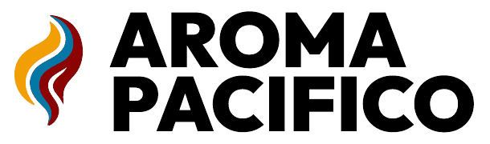
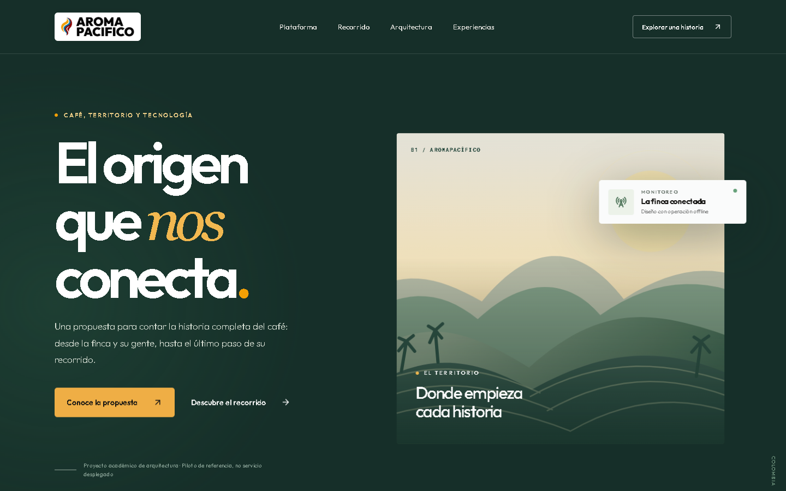

<p align="center">
  
</p>

# AromaPacífico Web 2.0

Sitio institucional interactivo para comunicar el diseño académico de AromaPacífico: monitoreo del cultivo, trazabilidad del café y servicios propuestos de drones e inferencia. La experiencia combina una narrativa editorial, movimiento accesible y una galería de diagramas oficiales sin depender de servicios de producción.

## Estado y alcance

La web representa una **arquitectura propuesta** y el **diseño de un piloto académico**. La infraestructura está definida hasta `terraform plan`; este repositorio no prueba que AWS esté desplegado, que existan sensores transmitiendo, funciones Lambda operativas, vuelos de producción ni datos reales de sacos.

La consulta pública es una demostración local con datos ficticios. El despliegue eventual de esta web estática es independiente de la infraestructura del piloto.

## Vista del sitio



Captura auténtica de la exportación estática ejecutada localmente. También se versionan cinco momentos reales del recorrido: [0 %](public/screenshots/journey-scroll-0.png), [25 %](public/screenshots/journey-scroll-25.png), [50 %](public/screenshots/journey-scroll-50.png), [75 %](public/screenshots/journey-scroll-75.png) y [100 %](public/screenshots/journey-scroll-100.png). El [vídeo de evidencia](public/evidence/journey-scroll.webm) recorre la escena completa en Chromium.

## Características principales

- Identidad oficial con Outfit, Roboto Mono y la paleta institucional.
- Hero editorial con parallax progresivo, cambio de escala y transición hacia la siguiente sección.
- Storytelling ligado al desplazamiento con variables CSS, un listener pasivo y `requestAnimationFrame`.
- Revelado textual por frases, tarjetas apilables y recorrido SVG que avanza con el scroll.
- Métricas de planificación documentadas, diferenciadas de cualquier dato operacional.
- Recorrido visual finca → transporte → centro de acopio → puerto → comprador.
- Tres experiencias claramente etiquetadas como prototipos de interfaz.
- Consulta de saco con carga ilustrativa, validación y resultado ficticio.
- Galería de cuatro diagramas oficiales almacenados localmente.
- Visor modal con zoom, restablecimiento, ajuste, paneo, teclado y gestos táctiles.
- Navegación sticky, estado de sección, menú móvil y cierre con `Escape`.
- Exportación estática, metadatos SEO y soporte para `prefers-reduced-motion`.

## Secciones del sitio

1. Presentación y alcance académico.
2. Pilares de plataforma: cultivo, trazabilidad, drones e inferencia.
3. Recorrido conceptual del café.
4. Arquitectura de AromaPacífico.
5. Prototipos para caficultor, transportador y comprador.
6. Servicios de drones contemplados en el diseño.
7. Demostración ficticia de consulta.

## Animaciones e interacciones

El movimiento utiliza CSS, transformaciones, opacidad, `IntersectionObserver` y un controlador de scroll nativo; no se añadió una dependencia de animación. Un único listener pasivo agrupa las lecturas en `requestAnimationFrame` y escribe variables CSS directamente, sin provocar renders React por cada cambio de desplazamiento.

- El hero aplica parallax discreto al título, la ilustración y los elementos decorativos.
- Las frases resaltan conceptos completos sin duplicar ni ocultar el texto accesible.
- Los tres pilares se apilan con `position: sticky` en escritorio y vuelven al flujo normal en pantallas táctiles pequeñas.
- El recorrido reserva cinco alturas de viewport en escritorio, mantiene una escena sticky y transiciona entre cinco etapas protagonistas.
- La conexión horizontal se llena entre los centros de los nodos; en móvil se convierte en una narrativa vertical sin sticky.
- Los diagramas combinan entrada progresiva con una transición contenida hacia el visor.
- Las barras y contadores presentan solo valores de planificación trazables a la documentación.

Las entradas no se repiten. `prefers-reduced-motion` y `update: slow` desactivan el movimiento complejo; el contenido mantiene su estado final y permanece visible cuando JavaScript no está disponible.

## Visor de diagramas

Cada tarjeta abre una copia local del diagrama en un visor accesible. Controles disponibles:

- acercar, alejar, escala 100 % y ajustar a pantalla;
- arrastrar con puntero o usar flechas del teclado;
- `+`, `-`, `0` y `F` como atajos;
- cerrar con botón, fondo o `Escape`;
- foco inicial, ciclo de foco y devolución del foco al disparador.

## Stack tecnológico

- Next.js 16 con App Router y exportación estática.
- React 19 y TypeScript 5.
- CSS nativo con tokens de diseño y media queries.
- Lucide React para iconografía de interfaz.
- Node Test Runner para comprobaciones del proyecto.

## Requisitos previos

- Node.js 22, según [`.nvmrc`](.nvmrc).
- npm incluido con Node.js.

## Instalación

```bash
git clone https://github.com/aromapacifico-devops/AromaPacifico-web.git
cd AromaPacifico-web
npm ci
```

Usa `npm install` únicamente al cambiar dependencias y versiona el `package-lock.json` resultante.

## Ejecución local

```bash
npm run dev
```

Abre <http://localhost:3000>.

## Scripts disponibles

| Comando | Propósito |
|---|---|
| `npm run dev` | Servidor de desarrollo con Turbopack |
| `npm run typecheck` | Verificación de TypeScript sin emitir archivos |
| `npm run lint` | Reglas de ESLint y Next.js |
| `npm run test` | Pruebas con Node Test Runner |
| `npm run test:visual` | QA de integración con Playwright en cinco breakpoints |
| `npm run build` | Compilación y exportación estática en `out/` |
| `npm run start` | Servidor Next.js; no es necesario para el artefacto estático |

## Estructura del proyecto

```text
src/
├── app/
│   ├── globals.css                 Tokens, layout, responsive y movimiento
│   ├── layout.tsx                  Fuentes y metadatos
│   └── page.tsx                    Composición de la página
├── components/
│   ├── architecture/
│   │   ├── architecture-section.tsx
│   │   ├── diagram-card.tsx
│   │   └── diagram-viewer.tsx
│   ├── header.tsx
│   ├── logo.tsx
│   ├── motion-controller.tsx
│   └── trace-demo.tsx
└── content/site.ts                 Contenido y metadatos tipados
public/
├── architecture/                   Cuatro diagramas oficiales locales
├── brand/                           Logotipo oficial
├── fonts/                           Outfit y Roboto Mono autoalojadas
└── illustrations/                  Ilustración del hero
tests/project.test.mjs              Integridad, rutas y accesibilidad estática
```

## Arquitectura del frontend

La página se renderiza principalmente como Server Component. Solo la navegación, el controlador de movimiento, la demo y el visor usan lógica de cliente. El controlador no almacena el progreso en estado React: actualiza propiedades CSS sobre los elementos implicados y mantiene el trabajo por frame acotado. El contenido, las métricas de diseño y los metadatos de diagramas viven en `src/content/site.ts`, por lo que las tarjetas, las rutas locales y los enlaces de procedencia comparten una única fuente.

## Fuente de los diagramas

Las copias de `public/architecture/` proceden de [`docs/architecture/diagrams/`](https://github.com/aromapacifico-devops/aromapacifico-devops-docs/tree/main/docs/architecture/diagrams):

| Copia local | Fuente oficial |
|---|---|
| `01-end-to-end.drawio.png` | [Flujo de extremo a extremo](https://github.com/aromapacifico-devops/aromapacifico-devops-docs/blob/main/docs/architecture/diagrams/01-end-to-end.drawio.png) |
| `03-connectivity-and-centers.drawio.png` | [Conectividad y centros](https://github.com/aromapacifico-devops/aromapacifico-devops-docs/blob/main/docs/architecture/diagrams/03-connectivity-and-centers.drawio.png) |
| `19-inference-functions.drawio.png` | [Funciones de inferencia](https://github.com/aromapacifico-devops/aromapacifico-devops-docs/blob/main/docs/architecture/diagrams/19-inference-functions.drawio.png) |
| `21-flight-object-transport.drawio.png` | [Transporte de objetos de vuelo](https://github.com/aromapacifico-devops/aromapacifico-devops-docs/blob/main/docs/architecture/diagrams/21-flight-object-transport.drawio.png) |

No se alteraron las decisiones arquitectónicas ni se cargan imágenes remotas durante la visita.

## Branding y design system

El logotipo local procede del recurso aprobado [`brand-logo.png`](https://github.com/aromapacifico-devops/aromapacifico-devops-docs/blob/main/docs/architecture/diagrams/assets/brand-logo.png). Se conserva su proporción y color.

Referencias oficiales:

- [Identidad visual](https://github.com/aromapacifico-devops/aromapacifico-devops-docs/blob/main/docs/design/visual-identity.md)
- [Sistema de diseño](https://github.com/aromapacifico-devops/aromapacifico-devops-docs/blob/main/docs/design/design-system.md)
- [Manual de branding en PDF](https://github.com/aromapacifico-devops/aromapacifico-devops-docs/blob/main/docs/design/aroma-pacifico-branding.pdf)
- [Archivo de diseño en Figma](https://www.figma.com/design/sFAlRb7c5pxXKsQK7ZRub0/AromaPacifico)

## Pruebas

```bash
npm run typecheck
npm run lint
npm run test
npm run build
```

Las pruebas comprueban diagramas locales y sus firmas PNG, rutas y metadatos, navegación, declaración de datos ficticios, ausencia de llamadas a APIs, controles del visor, branding y movimiento reducido.

Para el QA visual instala Chromium una vez y ejecuta:

```bash
npx playwright install chromium
npm run test:visual
```

La suite visual comprueba cinco estados diferenciados del recorrido, etapa activa, transformaciones efectivas, geometría de las conexiones, ausencia de cruces con texto, overflow, breakpoints de 360 a 1440 px y movimiento reducido.

## CI/CD

El workflow [`.github/workflows/ci.yml`](.github/workflows/ci.yml) usa Node 22 y ejecuta `npm ci`, pruebas estáticas, Chromium/Playwright, lint, typecheck y build en pull requests y pushes a `main`. La presencia del workflow no implica por sí sola que un build remoto haya terminado correctamente; confirma el estado en [GitHub Actions](https://github.com/aromapacifico-devops/AromaPacifico-web/actions).

## Despliegue estático o Vercel

`next.config.ts` define `output: "export"`; `npm run build` genera `out/`. Ese directorio puede publicarse en hosting estático. Vercel también puede importar el repositorio como proyecto Next.js, sin base de datos ni credenciales AWS.

No hay una URL pública de Vercel documentada. No se debe asumir que la web está publicada.

## Variables de entorno

| Variable | Requerida | Uso |
|---|---|---|
| `NEXT_PUBLIC_SITE_URL` | No | URL pública absoluta para usar la captura local en Open Graph cuando exista un despliegue |

No se necesitan secretos. Nunca añadas credenciales de AWS a este repositorio.

## Limitaciones conocidas

- Los diagramas y parte de la documentación técnica original están en inglés.
- La demo no persiste información ni consulta un backend.
- Las pantallas de experiencia son representaciones CSS, no aplicaciones funcionales.
- Sin `NEXT_PUBLIC_SITE_URL`, Open Graph usa como respaldo el logotipo del repositorio oficial de documentación; con la variable definida usa la captura local.
- El alcance de infraestructura permanece en `terraform plan`.

## Roadmap

- Validar copy final y traducción de diagramas con responsables del proyecto.
- Ejecutar auditorías Lighthouse y lectores de pantalla en el entorno de publicación.
- Confirmar con el equipo de diseño cualquier futura variante negativa exportada del logo.

## Créditos y atribuciones

Proyecto académico AromaPacífico. Identidad, diagramas y decisiones técnicas: [repositorio de documentación](https://github.com/aromapacifico-devops/aromapacifico-devops-docs). Implementación del sitio: [AromaPacifico-web](https://github.com/aromapacifico-devops/AromaPacifico-web).

Los recursos oficiales se incorporan para comunicar este proyecto y conservan enlace a su procedencia. Revisa los permisos de la organización antes de reutilizarlos fuera de AromaPacífico.
